<p align="center">
  
</p>

<p align="center">
  <b>SCAMSHIELD AI Hackathon</b> · 42 Abu Dhabi × Abu Dhabi Police · Team maze<br>
  <sub>Hackathon prototype, not an official police service. Saqr (صقر) means falcon.</sub>
</p>

<p align="center">
  <a href="#the-problem-and-the-solution"><b>Problem and solution</b></a> ·
  <a href="#technical-choices-tools-apis-and-data"><b>Technical choices</b></a> ·
  <a href="#how-to-build-and-run-the-project"><b>Build and run</b></a><br>
  <a href="#try-it">Try it</a> ·
  <a href="#how-it-works">How it works</a> ·
  <a href="#accuracy">Accuracy</a> ·
  <a href="#visual-similarity-and-bilingual-ai">Visual similarity</a> ·
  <a href="#privacy-and-safety">Privacy</a> ·
  <a href="#route-to-a-police-pilot">Pilot</a> ·
  <a href="#honest-limits">Limits</a>
</p>

<br>

**Saqr checks a link before the citizen opens it, and says why in English and Arabic.**

SCAMSHIELD AI Hackathon submission · 42 Abu Dhabi × Abu Dhabi Police · Team maze · MVP / prototype on the `master` branch (identical to `main`)

| Submission guideline (README.md) | Section |
|---|---|
| The problem and the solution | [The problem and the solution](#the-problem-and-the-solution) |
| Technical choices, tools, APIs and data | [Technical choices, tools, APIs and data](#technical-choices-tools-apis-and-data) |
| How to build and run the project | [How to build and run the project](#how-to-build-and-run-the-project) |

<br>

## The problem and the solution

**The problem.** Scam links reach UAE residents through SMS, WhatsApp, email, search ads and fake Google Maps listings. They imitate TAMM, Abu Dhabi Police, UAE PASS, Emirates Post, e&, du and the banks, are registered hours before the campaign starts, hide behind URL shorteners and redirect chains, and show a harmless page to scanners (cloaking). By the time a victim reports one, the money is gone.

**The solution.** Every check runs the same pipeline: follow redirects to the real destination, look-alike rules for the official UAE entities and ~50 global brands, a trained URL model, global phishing feeds, WHOIS / DNS / TLS age, a page check that compares what a bot, a phone and a computer see, a visual brand-clone check and an optional AI judge. A **Proactive Hunter** finds look-alike domains nobody has reported yet. Confirmed scams flow to a DNS blocklist (phones with the Saqr DNS profile stop opening them), to the police Command Center with an evidence dossier, and to drafted registrar / hosting abuse notices.

**98.6% accuracy as deployed** (recall 98.5%, false-alarm rate 1.25%), measured on 800 live links with threat feeds on as in production; the test scams were publicly reported scams, so the feeds had already seen most of them. With every blocklist switched off, Saqr still caught 75% of the scams (63% blocked outright) and was right 98.4% of the time when it flagged. Details: [Accuracy](#accuracy).

<p align="center">
  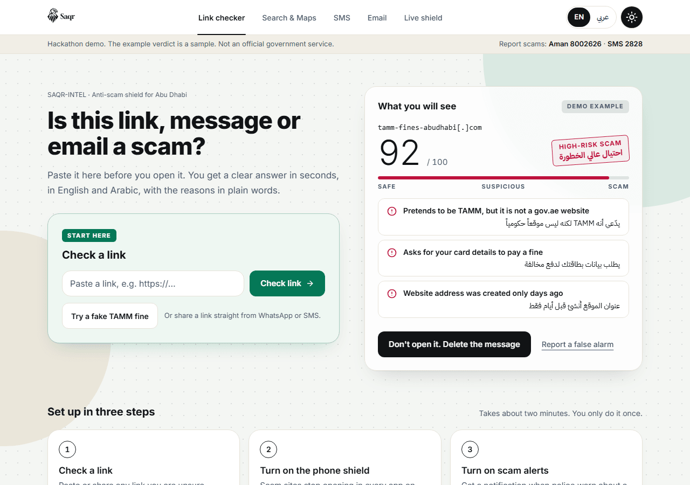
  <br>
  <sub>The citizen website, Link checker window. The verdict card shown is the demo example; press "Try a fake TAMM fine" for a live scan.</sub>
</p>

<sub>The repo and hostnames keep the old `saqr-intel` name (formerly SAQR-INTEL). Brand: falcon mark, serif wordmark, light by default with a dark theme, English and Arabic (`frontend/DESIGN.md`).</sub>

<br>

## Try it

| | Link |
|---|---|
| Citizen app (website / PWA) | https://saqr-intel.vercel.app/citizen |
| Police Command Center | https://saqr-intel.vercel.app/police (locked: officer passcode provided to judges in the submission document) |
| API | https://saqr-intel-api.onrender.com/health (also `/docs`) |
| 5-minute demo script | [docs/DEMO_SCRIPT.md](docs/DEMO_SCRIPT.md) |

**A two-minute path**

1. Open `/citizen`, **Link checker**, press **Try a fake TAMM fine**. The result card shows the score out of 100, the HIGH-RISK SCAM stamp, the Safe | Suspicious | Scam meter and the top three reasons in English and Arabic. **Full report** opens every reason.
2. Open the **Search & Maps** tab and tap the sponsored ad **Abu Dhabi Police Traffic Fine Payment**. This time the whole screen becomes the red block page, because the resident was about to open the link.
3. Open **Live shield**: the blocks you just made appear in the anonymous **Live Crowd-Shield** list.
4. On `/police`, within about 4 seconds the new rows appear in **Live Citizen Interception Stream** (rows without the grey **Demo** tag are real).
5. Optional: switch to **العربية** in the header; the whole page turns right-to-left.

> [!NOTE]
> The backend runs on a free Render instance that sleeps when idle. The first check can take up to about a minute while it wakes up; the citizen page sends a quiet wake-up ping when it opens. If you see "Could not complete the scan", wait 30-60 seconds and press **Try again**.

<br>

## How it works

<p align="center">
  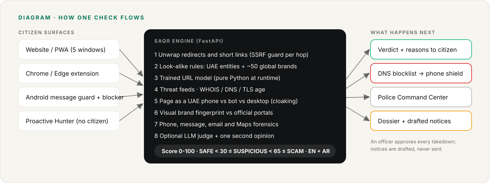
  <br>
  <sub>A diagram of the flow, not a screenshot.</sub>
</p>

| | Step | What Saqr does |
|---|---|---|
| 01 | **Check** | A citizen pastes or shares a link, an SMS / WhatsApp text, an email, a phone number or a Maps listing; the extension and Android app send what the user is about to open; the Proactive Hunter sends look-alike domains nobody has reported. |
| 02 | **Unwrap** | Follows the link hop by hop to its real destination: 30x, meta refresh, JavaScript stub pages, `?url=` wrappers and 100+ shorteners, with an SSRF guard on every hop. Every page read on the chain is judged; the worst hop wins. |
| 03 | **Inspect** | Look-alike rules (typosquat, homoglyph / punycode, TLD swap, brand + lure words) for 8 UAE entities and ~50 global brands; the trained URL model; Phishing Army and OpenPhish feeds; WHOIS / DNS / TLS (domain and certificate age, registrar, ASN); the page fetched as a UAE phone and as a bot, and as an iPhone vs a desktop (cloaking); card / OTP / Emirates ID form fields, in Arabic too. |
| 04 | **Compare** | A visual fingerprint of the page (title, brand assets, favicon hash, colours, form shape) against baselines of 11 official portals: is this a clone of TAMM, ADCB or Abu Dhabi Police on someone else's domain? |
| 05 | **Explain** | A score from 0 to 100: SAFE < 30 ≤ SUSPICIOUS < 65 ≤ HIGH-RISK SCAM. Every flag carries its points and a reason in English and Arabic; the response includes a per-layer score breakdown. An optional AI judge (Gemini / OpenAI) can add a verdict and asks a second model when unsure. |
| 06 | **Protect** | The citizen sees an inline verdict card, or a full-screen block page when about to open a scam. High-risk domains go to a DNS blocklist pushed to the phone shield (NextDNS) every 60 s, with an optional scam-alert push. |
| 07 | **Act** | The police Command Center sees the scan live, clusters scans into syndicates, exports a takedown dossier with SHA-256 evidence hashes, broadcasts a bilingual warning to every open citizen page, and drafts (never sends) registrar and hosting abuse notices. |

<details>
<summary><b>Architecture (text)</b></summary>

```
 Citizen PWA (/citizen)   Browser extension (MV3)        Phone DNS shield (NextDNS profile)
 paste/share link, SMS,   every navigation, Gmail /      blocks published domains in every app
 email, Maps listing      Outlook, search + Maps badges          ^
          \                    |                                 |
           v                   v                                 |
   FastAPI  POST /api/analyze-url · /api/batch-verdict · /api/analyze-email · /api/analyze-message
            · /api/scan-maps · /api/check-phone
   pipeline.analyze_url:
     1 redirect resolver (30x, meta refresh, JS stubs, ?url= wrappers, 100+ shorteners; SSRF guard per hop)
     2 look-alike rules (typosquat, homoglyph / punycode, TLD swap, brand + lure words)
     3 URL model (pure-Python inference)        4 threat feeds (Phishing Army, OpenPhish)
     5 WHOIS / DNS / TLS (domain + cert age, registrar, ASN), known syndicate infrastructure
     6 page sandbox: Playwright as a UAE phone, or two-view HTTP fetch in the cloud; cloaking + form fields
     7 LLM judge (Gemini / OpenAI, optional; page text passed as untrusted <evidence>)
     -> score 0-100, verdict SAFE < 30 <= SUSPICIOUS < 65 <= HIGH-RISK SCAM, EN + AR reasons
          |                        |                               |
          v                        v                               v
   DNS blocklist (JSON / RPZ)   syndicate graph + WS /ws/live    /police command center, dossier,
   -> NextDNS denylist          (union-find clustering)          abuse notices, push alerts
          ^
   Proactive Hunter (look-alike sweep, newly-registered domains, crt.sh, CT monitor)
   -> offline triage -> the same pipeline (channel PROACTIVE_HUNTER)
```

Code: `main.py`, `saqr/pipeline.py`, `saqr/intel/` (one module per stage), `saqr/routers/` (HTTP API), `frontend/` (Next.js 16), `extension/` (Chrome / Edge), `android-app/` (Kotlin). SQLite via aiosqlite.

</details>

<details>
<summary><b>Judging criteria → where to see it</b></summary>

| Criterion | What Saqr does | Where in the demo |
|---|---|---|
| **Detection accuracy (30)** | Rules + URL model + feeds + network + page evidence; weak page signals score 0 without a strong signal (fewer false alarms on real bank / gov sites); redirect / shortener resolver; bot-vs-phone and phone-vs-computer cloaking checks; visual brand-clone check. As deployed (800 live links, feeds on; the test scams were publicly reported, so the feeds had seen most): 98.6% accuracy, 98.5% recall, 1.25% false alarms; with every blocklist off it still caught 75% of the scams. Sealed sample C: 0.65% block / 4.1% warn false alarms on 460 never-trained legit pages (its phishing half had only 3 URLs, too few to measure recall, see [Accuracy](#accuracy)) | `/citizen` Link checker ("Try a fake TAMM fine"); `tools/evaluate.py` and `tools/predict.py`; `/police` model card (`GET /api/model/metrics`) |
| **Early detection & coverage (25)** | Proactive Hunter (look-alike DNS sweep, newly registered domains, certificate search); pre-click badges on Google / Bing results, sponsored ads and Maps cards; phone DNS shield; email, SMS text, Maps listing and phone-number checks | `/police` "Proactive Hunt" card, "Threats Caught Pre-Victim" KPI, "Run sweep now"; `/citizen` Search & Maps tab; browser extension on google.com / bing.com / Maps |
| **Explainability & actionability (20)** | Every flag carries an EN + AR reason and its points; the URL model returns its top feature reasons; one-click takedown dossier with WHOIS, hosting, TLS, redirect chain, SHA-256 evidence hashes and ready-to-send abuse notices; evidence pack (.zip) | Result card and full-screen block page on `/citizen`; extension block page; `/police` evidence dossier + "Export Official Takedown Dossier" |
| **UAE relevance & innovation (15)** | UAE entity registry (Arabic names, aliases, official domains); Arabic field patterns (رمز التحقق, رقم الهوية ...); sandbox as a UAE phone (`ar-AE`, Asia/Dubai, Abu Dhabi location); bilingual RTL UI; police warning broadcast to citizens; X warning composer; RPZ feed format for telecom DNS | `/citizen` in العربية; `/police` "Broadcast Official Warning"; `GET /api/dns-blocklist?format=rpz` |
| **Feasibility (10)** | Pure-Python runtime on a 512 MB free Render instance (no numpy / sklearn / browser in the cloud); Next.js on Vercel; extension needs no build; offline test suite | `render.yaml`, `requirements.txt`, [How to build and run the project](#how-to-build-and-run-the-project) |

</details>

<br>

## Technical choices, tools, APIs and data

| Area | What Saqr uses |
|---|---|
| **Backend** | Python 3.11+, FastAPI (`main.py`, `saqr/`), SQLite via aiosqlite; Playwright for the page sandbox on a laptop, an HTTP fetch in the cloud |
| **Frontend** | Next.js 16 + React + TypeScript + Tailwind (`frontend/`): citizen app / PWA (`/citizen`) and police Command Center (`/police`), English and Arabic (RTL) |
| **Android app** | Native Kotlin + Jetpack Compose (`android-app/`): message guard and web blocker |
| **Browser extension** | Chrome / Edge Manifest V3 (`extension/`), no build step |
| **AI and models** | Trained URL model: logistic regression over hashed character n-grams + gradient-boosted trees (LightGBM), trained with scikit-learn / LightGBM, run in pure Python at runtime. AI judge: Google Gemini (or OpenAI) when a key is set, with one second opinion from another model when unsure. Optional personal email model trained in the browser |
| **APIs and services** | Gemini API (or OpenAI), NextDNS API (phone DNS shield), Web Push (scam alerts), WHOIS / DNS / TLS lookups, Phishing Army and OpenPhish feeds, crt.sh / certificate transparency, whoisds.com newly registered domains, image.thum.io (optional screenshots), Google Places (optional, `GOOGLE_MAPS_API_KEY`), OpenStreetMap / Nominatim |
| **Hosting** | Backend on Render (free tier, `render.yaml`), frontend on Vercel, code on GitHub |
| **Data** | Public labelled URL sets for training and holdouts (PhreshPhish, PhiUSIIL, Phishing.Database, Phishing Army, Tranco, JPCERT/CC, Hannousse, PhishTank, OpenPhish, HuggingFace sets): sources and licences in [Data and licences](#data-and-licences); measured results in [Accuracy](#accuracy) |

**Why these choices**

- **Pure-Python runtime** so the backend fits a 512 MB free Render instance (no numpy / sklearn / browser in the cloud); training runs in a separate venv on a developer machine.
- **Rules are the floor:** hard evidence is never lowered by the AI, and without an AI key the rules engine and URL model decide alone; nothing breaks.
- **Weak signals need strong evidence:** weak page signals (log-in form, urgent words, brand mention) score 0 without a strong signal, to avoid false alarms on real bank / gov sites.
- **No browser on the server:** Render has no browser, so the cloaking check uses two HTTP views; Playwright stays on the laptop.

<br>

## One shield, four surfaces

The same engine and the same verdict reach the citizen wherever the scam arrives.

<table>
  <tr>
    <td width="50%">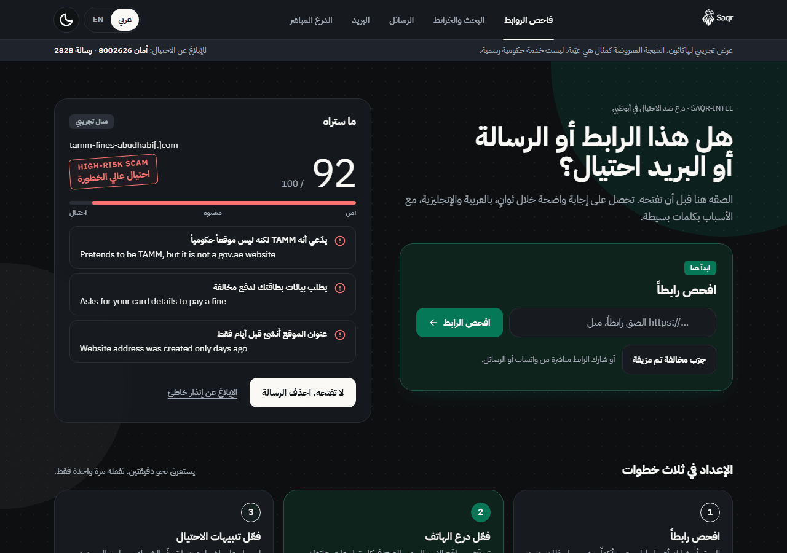</td>
    <td width="50%">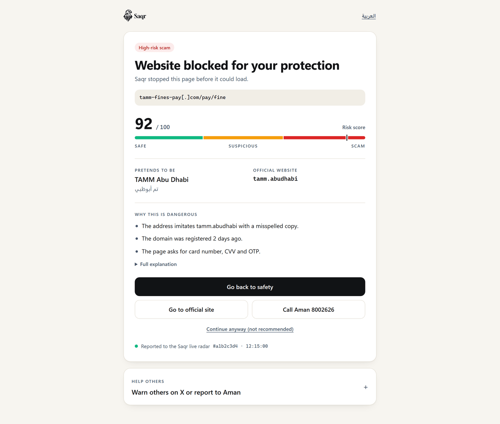</td>
  </tr>
  <tr>
    <td><sub><b>Website / PWA.</b> Five windows: Link checker, Search & Maps, SMS, Email, Live shield. Arabic and dark theme shown. Installs as an app; Android can share a link straight to it.</sub></td>
    <td><sub><b>Chrome / Edge extension.</b> Checks every page on navigation and replaces a scam with this block page, one language at a time. Also badges Google / Bing results, ads and Maps cards before the click.</sub></td>
  </tr>
  <tr>
    <td width="50%">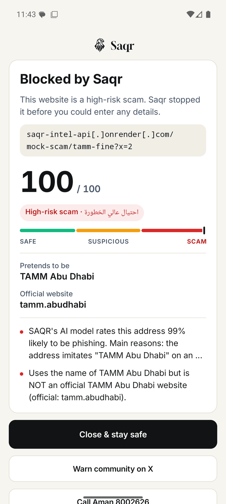</td>
    <td width="50%">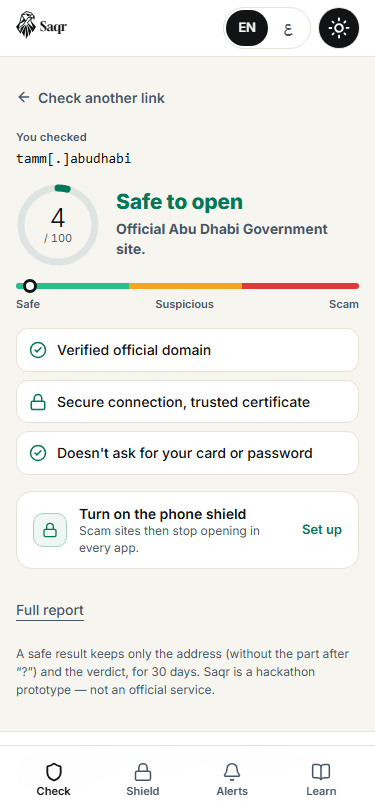</td>
  </tr>
  <tr>
    <td><sub><b>Android app.</b> A message guard checks links and code requests in new SMS, WhatsApp and email notifications; a web blocker covers a high-risk site with this screen. Emulator only so far.</sub></td>
    <td><sub><b>Phone.</b> A safe verdict too: the real TAMM site is recognised as official. With the Saqr DNS profile, the phone refuses scam domains in every app, and a push alert explains why.</sub></td>
  </tr>
</table>

<details>
<summary><b>More screenshots</b> (extension popup, Android shield and notification, phone home and alerts)</summary>

<table>
  <tr>
    <td width="33%">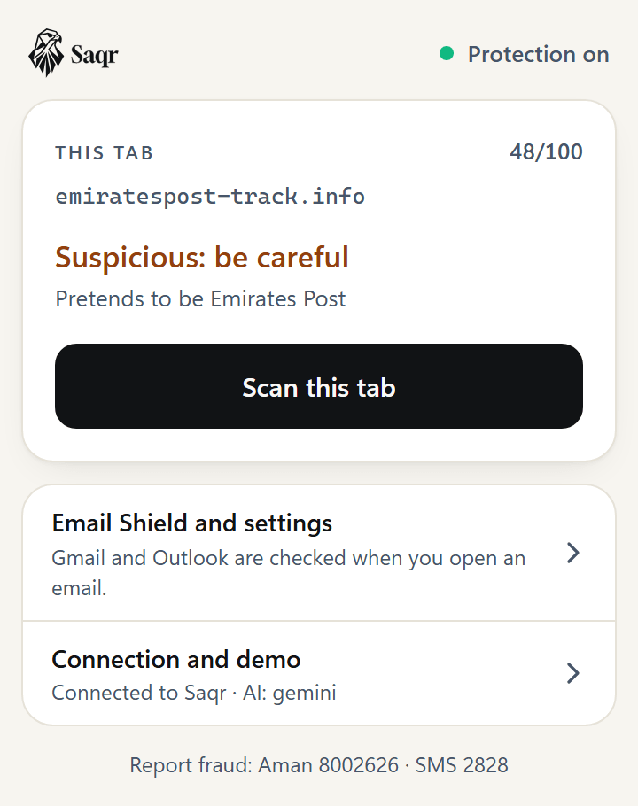</td>
    <td width="33%">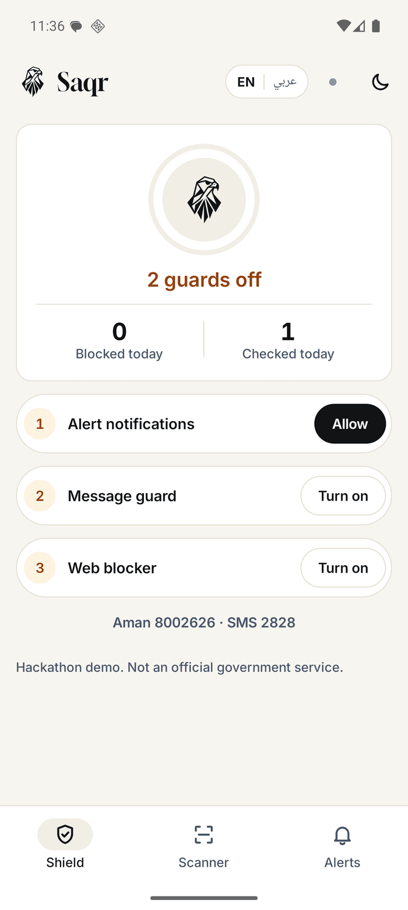</td>
    <td width="33%">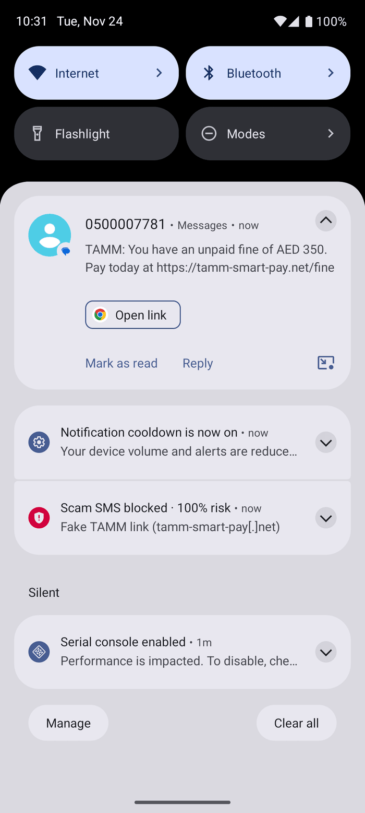</td>
  </tr>
  <tr>
    <td><sub>Extension popup on a suspicious tab.</sub></td>
    <td><sub>Android Shield tab: three steps, each with its own consent.</sub></td>
    <td><sub>Message guard notification for a demo scam SMS.</sub></td>
  </tr>
  <tr>
    <td width="33%">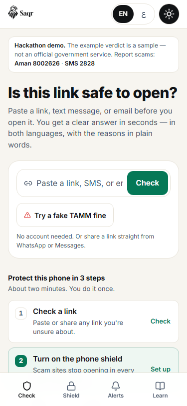</td>
    <td width="33%">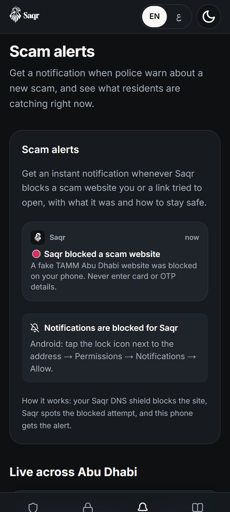</td>
    <td width="33%">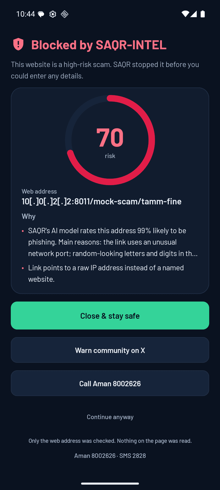</td>
  </tr>
  <tr>
    <td><sub>Phone home screen.</sub></td>
    <td><sub>Scam-alert setup on a phone (dark theme).</sub></td>
    <td><sub>Android web blocker over Chrome.</sub></td>
  </tr>
</table>

</details>

<details>
<summary><b>Detection before the victim interacts</b></summary>

- **Proactive Hunter** (`saqr/intel/hunter.py`, `lookalike_gen.py`; `GET /api/hunter/detections`, `/status`, `POST /api/hunter/sweep`). Sources: `lookalike_sweep` (deterministic typo / homoglyph / hyphen / TLD-swap / brand + lure names of the 8 official UAE entities, resolved in DNS: registered ones are leads), `nrd` (the free daily newly-registered-domains list from whoisds.com, filtered by brand keywords), `crtsh` (new certificates naming a UAE brand), `ct` (the certificate-transparency monitor). Each lead gets an offline triage (rules + URL model); registered look-alikes from the sweep and other leads scoring 35+ get the full scan. Lead time and later citizen visits are computed per detection, so "caught before any citizen saw it" is measured, not claimed. LLM is off for the hunt.
- **Pre-click shield** (`POST /api/batch-verdict`, up to 200 links, offline evidence only, nothing saved; `POST /api/check-phone`). The extension badges organic results, sponsored ads (ad wrapper resolved to the advertiser), knowledge-panel and Maps "Website" buttons, and helpline numbers that are not the official ones.
- **Phone DNS shield**: `/api/ios-dns-profile`, `/api/android-dns-config`; high-risk domains are pushed to a NextDNS denylist every 60 s and right after a high-risk scan; blocked visits can trigger a Web Push alert.
- **Browser navigation**: the extension checks every page on navigation (fast check, deep scan only when suspicious) and replaces scams with a block page.
- **Android app** (`android-app/`, native Kotlin): a message guard checks links and code requests in new SMS, WhatsApp and email notifications (an on-device filter decides what is sent), and a web blocker reads only the address bar of Chrome, Samsung Internet, Firefox and Edge and covers a high-risk site with a full-screen "Blocked by Saqr" screen (suspicious sites get a quieter alert). Both use `ANDROID_APP_GUARD` and need the user's consent; see `android-app/README.md`.
- **Telecom feed**: `GET /api/dns-blocklist` (JSON) and `?format=rpz` (zone file). Official, trusted and shared-hosting domains (vercel.app, onrender.com ...) are never published.

</details>

<br>

## Visual similarity and bilingual AI

**Visual brand clone.** `saqr/intel/brand_fingerprint.py` compares a fetched page's title / site name, brand assets, favicon hash, colours and form shape with baselines of 11 official portals: 6 full (Abu Dhabi Police, Emirates Post, Salik, ADCB, FAB, e&) and 5 partial (TAMM and UAE PASS are JavaScript-only shells, ICP and Emirates NBD did not answer, du disallows fetching). A match of 75 or more on a non-official domain is `VISUAL_BRAND_CLONE_DETECTED` (+35, strong); 50-74 is `VISUAL_BRAND_SIMILARITY` (+10, weak). In the demo, the fake TAMM page scores 82% similar to TAMM, while a news article scores 32%. On the 460 legitimate pages of sample C it flagged 0, and on the 3 phishing URLs of sample C it fired 0 times; how often it fires on real phishing is still not measured (3 URLs are far too few).

**Screenshot similarity** (optional, weak). A dHash of a thum.io thumbnail. Unrelated white portals already look 70-75% alike, so it only adds points next to a fingerprint match and never makes a clone on its own. See [Privacy and safety](#privacy-and-safety) for what it sends.

**Bilingual reasons.** Every flag, explanation, awareness alert and the whole UI exist in English and Arabic (RTL). Arabic specifics:

- Registry of 8 UAE entities (Abu Dhabi Police, TAMM, Emirates Post, e&, du, UAE PASS, FAB, ADCB) with Arabic names, aliases and official domains, plus 15 other trusted UAE sites (`saqr/intel/registry.py`). Any registered domain under `gov.ae` counts as official (TDRA only gives `gov.ae` names to government bodies; `gov.ae.evil.com` does not count).
- Arabic form-field detection (OTP, card, CVV, Emirates ID, password, IBAN), Arabic-first sandbox headers, and Arabic code requests such as "يرجى إرسال رمز التحقق".
- Phone numbers are parsed with `phonenumbers` (`saqr/intel/phone_intel.py`): UAE mobile / landline / 800 / 600 / short codes, foreign numbers. A personal `+971 5x` mobile or a foreign number shown for a UAE institution is a strong scam sign (banks and telecoms are left out of the foreign-number rule: they have real numbers abroad). Numbers in `registry.VERIFIED_PHONES` were checked on the entity's own website; the other registry numbers are demo data.
- SMS / WhatsApp text: `POST /api/analyze-message` (links, sender, call-back numbers, "send us the OTP" requests in English and Arabic). Wording such as "fine", "urgent" or "Emirates ID" never scores on its own.
- Short brand names (du, fab, tamm, adcb) match only as whole tokens (no alarms on dubai, fabric, tammy).
- Email: SPF / DKIM / DMARC / ARC, look-alike Unicode letters, campaign matching (`POST /api/analyze-email`).

<br>

## Accuracy

All numbers measured on 2026-11-24 and stored in `saqr/intel/data/model_metrics.json` (sealed sample E: measured on 2026-11-25, recorded in the model card only). "Block" = HIGH-RISK, score ≥ 65; "warn" = SUSPICIOUS or worse, score ≥ 30. Full per-set tables, thresholds and what was tried and dropped: [docs/MODEL_CARD.md](docs/MODEL_CARD.md).

<!-- ACCURACY:START -->
| Test | What it measures | Result |
|---|---|---|
| **System as deployed**, live sample B: 800 live links (400 newest PhishTank phishing + 400 legitimate), threat feeds on as in production, no AI judge. The test scams were publicly reported scams, so the feeds had already seen most of them (387 of 400) | Accuracy of the system as deployed | **Warn: accuracy 98.6%, recall 98.5%, precision 98.75%, false-alarm rate 1.25%.** Block: accuracy 98.25%, recall 97.5%, false-alarm rate 1.0% |
| **Stress test**, same 800 links with every blocklist switched off (no AI judge) | Brand-new scams no list knows yet | With every blocklist switched off, Saqr still caught 75% of the scams (63% blocked outright) and was right 98.4% of the time when it flagged. False-alarm rate 1.25% warn, 1.0% block |
| Same sample, UAE official / bank / government / brand pages (224) | False alarms where they hurt most | **0** |
<!-- SAMPLE_D_ROW: sealed sample D (scams reported in the last day, never seen by the deployed model) goes here, e.g.
| **Sealed sample D**, N links reported in the last day, never seen by the deployed model | ... | ... |
-->
| **Sealed sample E** (2026-11-25), 125 scam links first listed in the last 17 hours, every blocklist off, no AI judge, code frozen first, scored once. A different, fresher sample than B (mostly OpenPhish, half on free hosting), so not comparable to the 75% on B | Fresh scams, with and without links that were already dead | Warn: 92.8% caught (116 of 125, 95% CI 86.9-96.2); **94.2% with dead links removed** (98 of 104, CI 88.0-97.3); 95.3% of pages still up (61 of 64). Block: 79.2% / 82.7% / 78.1%. Before the rule changes of this round the same links scored 92.0% / 93.3% / 93.8% at warn. Recall only: no legitimate half |
| **Sealed sample C**, 460 legitimate pages never trained on (code frozen first, scored once) | False alarms | Block: 3 of 460 = 0.65% (95% CI 0.2-1.9%). Warn: 19 of 460 = 4.1% (CI 2.7-6.4%) |
| Sample C, phishing half: only 3 URLs reported after the cut-off | Recall | 2 of 3 caught at warn and at block (95% CI 21-94%): **too few to measure recall** (see below) |
| Sample C combined, 3 phishing + 460 legitimate (99.35% legitimate) | Accuracy | Warn: 95.7% (CI 93.4-97.2%). Block: 99.1% (CI 97.8-99.7%); mostly reflects the false-alarm rate |
| UAE regression suite, 100 hand-written cases, offline | Regression check, not real-world accuracy | 46 of 50 scams caught, 0 of 50 legitimate flagged |
<!-- ACCURACY:END -->

**Sealed sample C, plainly.** The code was frozen and both halves sealed (SHA-256) before scoring, and each was scored once with no fix-and-rescore. Phishing had to be reported after the training cut-off (24 Nov 2026 21:10 UTC). At the first collection none was; at the second (22:26 UTC) PhishTank had 5, of which 3 qualified (new site, one per site); OpenPhish and Phishing.Database had none. Older phishing was not used as a substitute. The detection code did not change between the two halves. Of the 3, 2 were caught (scores 100 and 80) and 1 page on vercel.app was missed (20), so **recall is 2 of 3 with a 95% CI of 21-94%: not a usable measurement**. Of the 19 warnings on legitimate pages, 17 are free-hosting pages flagged by the URL model and 2 are articles on one UAE news site; 0 on 90 UAE official deep links, 60 brand pages, 60 log-in pages, 56 global news articles and 120 long-tail sites.

| Sample C, 460 legitimate pages (no feeds, no LLM) | Warn (≥ 30) | Block (≥ 65) |
|---|---:|---:|
| All | 19 (4.13%, 95% CI 2.7-6.4%) | 3 (0.65%, CI 0.2-1.9%) |
| UAE official 90, brand official 60, log-in pages 60, global news 56, Tranco long tail 120 | 0 | 0 |
| UAE news about scams (14) | 2 | 0 |
| Legit free-hosting pages (60) | 17 | 3 |

**Against the brief's targets** (accuracy 98%, recall 97.5%, false-alarm rate 1%), per configuration. *As deployed, on sample B* (800 live links, feeds on, publicly reported scams): accuracy 98.6% and recall 98.5% meet them at warn level; the false-alarm rate, 1.25%, is slightly above (1.0% at block level meets it). *With every blocklist switched off*: recall 75% at warn does not meet 97.5%. *On sample C*: accuracy 95.7% at warn and 99.1% at block, but the sample is 99.35% legitimate, so accuracy mostly reflects false alarms; recall 2 of 3 (CI 21-94%) says nothing either way about 97.5%, false alarms are 4.1% at warn (above target, all from free hosting and two news pages) and 0.65% at block. The new signals (phone-vs-computer cloaking, visual brand clone / similarity) caused 0 false alarms on the 460 legitimate pages and fired 0 times on the 3 phishing URLs (0 extra caught); their effect on recall is not measured.

**Misses.** Of the 100 phishing URLs missed at warn in sample B, 53 were already offline or blocked when scanned and 45 showed the fetcher an ordinary-looking page. Median scan 8.6 s, 95th percentile 16.5 s (20 scans in parallel).

**Retrain rejected.** A candidate model trained with hard negatives lost on the pre-agreed replace rule (validation recall at the strong cut 67.8% vs 68.7%; false-alarm-suite block false positives 22 vs 17), so the shipped model was kept. Its score is calibrated (Platt table, shown to citizens only; decisions use the raw probability).

**UAE regression suite** (`tests/uae_suite/cases.json`, `tools/eval_uae.py`, also run by `pytest`). The team wrote these cases by hand: scams and legitimate cases for each input type (website link, email, Google Maps listing, phone number, SMS / WhatsApp text), several in Arabic; every scam domain is invented. The legitimate side includes hard cases on purpose: a real-style bank email that talks about OTP and urgency, an official link with a long tracking query, a shop called "Dubai Fabrics", a restaurant whose Maps "website" is WhatsApp. Run offline with rules only. "Detected" = verdict not SAFE (phone: a caution / danger level).

| Measured 2026-11-24, offline | Scams detected | Legitimate flagged | Precision | Recall | False-alarm rate |
|---|---:|---:|---:|---:|---:|
| 50 cases (5 types x 10) | 25 / 25 | 0 / 25 | 1.00 | 1.00 | 0% |
| 100 cases (+50 "tricky" ones written before the run) | 46 / 50 | 0 / 50 | 1.00 | 0.92 | 0% |

It shows the engine does not flag these common legitimate UAE cases and catches these common scam patterns (every official legitimate case comes back `verified_official`). It does not show real-world accuracy: the cases were written by people who know the rules. One engine gap found while writing it was fixed in general (Arabic polite code requests).

<details>
<summary><b>Offline URL-model results</b> (address only: no network, no page fetch, no LLM, no feeds)</summary>

"Before" is the previous hostname-only model.

| Test set | Cut | Before: precision / recall / false-alarm rate | After: precision / recall / false-alarm rate |
|---|---|---|---|
| Hannousse holdout (11,426 URLs, never trained on) | block | 0.992 / 0.172 / 0.14% | 0.997 / 0.314 / 0.10% |
| Hannousse holdout | warn | 0.878 / 0.318 / 4.41% | 0.987 / 0.537 / 0.70% |
| Fresh phishing (49,359 URLs: JPCERT 2026-08/09, OpenPhish, PhishTank) | block | recall 0.108 | recall 0.194 |
| Fresh phishing | warn | recall 0.312 | recall 0.415 |
| False-alarm suite (13,725 legitimate URLs) | block | 0.30% | 0.09% |
| False-alarm suite | warn | 16.52% | 0.63% |
| Evasion variants of holdout URLs (23,891) | warn | 0.913 / 0.330 / 6.42% | 0.994 / 0.558 / 0.75% |

- UAE official deep links (1,046), global-brand official pages (2,081), Tranco deep links (2,242) and 52 hand-picked bank / government login pages: **0 false alarms** at either cut.
- Much of the held-out phishing sits on hosts an address model must not judge (Google Forms / Sites, QR and link shorteners, Dropbox, form builders) or on hacked older websites with ordinary addresses; the live checks handle those.

**Live sample B in detail** (`tools/evaluate.py --mode live`: redirects and shorteners followed, WHOIS / DNS / TLS, page fetched as a UAE phone and as a bot, no LLM, no Chromium, i.e. the Render setup). 400 of the newest PhishTank phishing URLs (not trained on) + 400 legitimate pages (UAE government and bank deep links, bank / government login pages, global-brand official pages, Tranco long-tail, legit free hosting). "Before" = the same scans judged by the previous rules.

| Live sample (800 URLs) | Cut | Before: precision / recall / false-alarm rate | After: precision / recall / false-alarm rate |
|---|---|---|---|
| without threat feeds | block | 0.984 / 0.605 / 1.00% | 0.984 / 0.630 / 1.00% |
| without threat feeds | warn | 0.970 / 0.725 / 2.25% | 0.984 / 0.750 / 1.25% |

</details>

<details>
<summary><b>Method: model, training data, holdouts</b></summary>

- **Model** (`saqr/intel/url_model.py`, `url_features.py`): stage 1 is logistic regression over hashed character n-grams and tokens of host, path and query; stage 2 is gradient-boosted trees over ~50 named features plus the stage-1 score, exported to JSON and walked in pure Python. Per-feature contributions become the EN / AR reasons. The model does not judge Tranco top-100k sites (unless on free hosting) or official domains.
- **Training data**: public labelled URL sets listed in [Data and licences](#data-and-licences) (PhreshPhish, PhiUSIIL, Phishing.Database, Phishing Army, Tranco, HuggingFace sets), plus `tools/augment.py`: real deep links harvested from UAE official and Tranco sites, synthetic look-alikes of the protected brands (capped weight), and evasion rewrites (scheme, www, case, slashes, percent-encoding, port, userinfo). Known biases handled: PhiUSIIL legit rows are all bare homepages and host-only feeds have no paths, so those sources are trained as bare hosts.
- **Evaluation protocol** (`tools/train_url_model.py --build-holdout`, `tools/evaluate.py --suite`): fixed holdout sets in `datasets/holdout/`: `hannousse` (a whole dataset never trained on), `fresh_phishing` (newest JPCERT months, OpenPhish, PhishTank), `fp_suite` (real UAE government / bank login and service pages, official brand deep links, free-hosting legit pages, 6,000 Tranco long-tail sites), `robustness` (evasion variants of holdout URLs). Every holdout site is listed in `tools/holdout_sites.txt.gz` and removed from training; validation is split by site, never by URL.
- **Frozen-sample protocol**: freeze code (record the `saqr/` tree SHA-256), seal the sample CSV (SHA-256) before scoring, score once with `tools/evaluate.py --mode live --records`, no fix-and-rescore of detection.

</details>

**Re-run it** (runtime venv, standard library only):

```bash
python tools/fetch_datasets.py                       # download the public sets -> datasets/ + MANIFEST.json
python tools/evaluate.py datasets/hannousse/dataset_B_05_2020.csv            # any labelled file
python tools/evaluate.py my.csv --url-col link --label-col verdict --positive bad,phish --mode system
python tools/evaluate.py sample.csv --mode live --records live.jsonl     # full pipeline, resumable
python tools/evaluate.py sample.csv --rescore live.jsonl                 # re-judge saved live evidence
python tools/evaluate.py --suite                     # the fixed holdout sets -> model_metrics.json
python tools/predict.py hidden_urls.csv -o predictions.csv [--url-col link] [--label-at block|warn] [--mode live]
python tools/eval_uae.py [--json out.json]           # the 100-case UAE suite, offline (--live: real network + LLM keys)
```

`--mode model` = URL model alone, `system` = the offline engine a scan runs first (rules + model, 65 = block, 30 = warn), `live` = the full pipeline with network (throw-away database, NextDNS and push disabled). Input can be CSV / TSV / JSON / JSONL / TXT / parquet; URL and label columns are auto-detected. `predict.py` writes url, label, score, verdict, reasons. Set `VISUAL_SCREENSHOTS=false` for evaluations. Retraining needs numpy, scipy, scikit-learn and lightgbm in a separate venv (developer machine only): `python tools/augment.py`, then `python tools/train_url_model.py [--data extra.csv] [--data feed.txt:1] [--no-recipe]`, then `tools/compare_models.py` (the pre-agreed replace rule).

<br>

## Where AI is used, and where it is not

| Used | Not used |
|---|---|
| **Trained URL model** on every link check (pure Python at runtime, its top feature reasons shown in EN / AR). | **Thresholds and hard evidence.** Rules decide what is strong evidence; weak page signals (log-in form, urgent words, brand mention) score 0 without a strong signal. Hard evidence is never lowered by the AI. |
| **AI judge** (Gemini, or OpenAI) when a key is set: reads the page text as untrusted evidence, with 6 invented UAE calibration examples. An unsure first answer (score 40-69 or confidence < 0.8) gets one second opinion from another model. | **Without a key**, the rules engine and URL model decide alone; nothing breaks (the demo scam page does not use the AI at all). |
| **Email**: an optional personal model trained in the browser from the citizen's own labels, and an optional "own AI" endpoint the citizen supplies. | **Hunter scans, official domains, seeded demo data and email scans' second opinion**: no LLM. |
| | **Takedowns**: notices are drafted, never sent. A person decides every action. |

<br>

## Privacy and safety

- **No account.** No name or phone number is asked for. A safe link's query string (the part after "?") is never stored.
- **Retention.** Safe results and email checks are deleted after `SCAN_RETENTION_DAYS` (30). Links judged to be scams are kept as blocklist / dossier evidence, but the message text a citizen pasted is removed after 30 days. Emails keep only sender, subject and a 500-character excerpt. The citizen app explains this next to every verdict and in the footer.
- **Android app.** Each feature has its own consent. The message guard sends only messages with a non-official link, a phone number + lure, or a code / card request; codes are masked. The web blocker reads only the browser address bar, never official domains or private hosts.
- **Third-party screenshots.** When `VISUAL_SCREENSHOTS` is on (the default), suspicious, non-official links are sent to the third-party service image.thum.io for a thumbnail. `VISUAL_SCREENSHOTS=false` stops it.
- **False alarms.** Any warning has "Report a false alarm" (domain, verdict, score and an optional note; no full URL). Reports are rate limited and go to the `/police` "False-alarm reports" queue, where an officer confirms or dismisses them; nothing is unblocked automatically.
- **`/police` is private.** `/police/login` asks for one shared passcode (`POLICE_PASSCODE`, 5 tries per 10 minutes); the browser then gets a signed, httpOnly cookie for 12 hours. Every officer call goes through the website's own `/api/officer/...` route, which adds the police API key (`POLICE_API_KEY`) on the server, so the key never reaches a browser. With the same key set on the backend, police endpoints refuse direct calls, and citizen pages only get public live events (official warnings and anonymised scan results, no IPs or email senders).
- **Demo scam sites** (saqr-demo-scam.vercel.app, aed-refund-claim.vercel.app) are harmless training replicas with an inert form.

<br>

## Police Command Center

`/police` (locked; officer passcode provided to judges in the submission document) uses the same Saqr design as the citizen site. It refreshes every 4 seconds and shows:

<table>
  <tr>
    <td width="50%">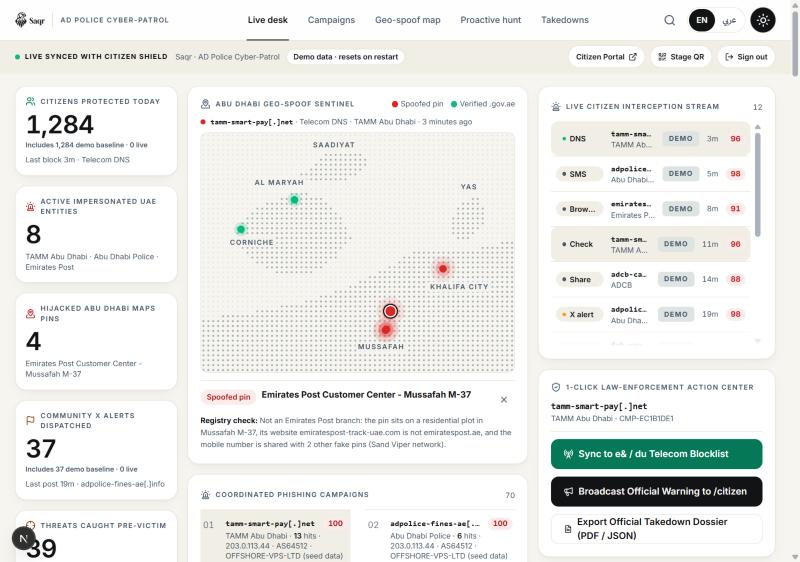</td>
    <td width="50%">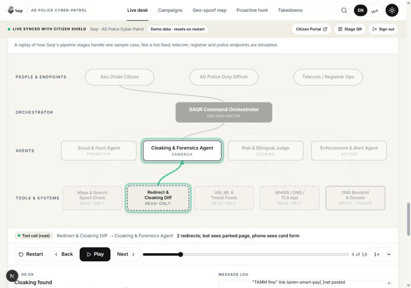</td>
  </tr>
  <tr>
    <td><sub><b>Command Center.</b> Counters, the geo-spoof map, the live stream and one-click actions. Pre-loaded rows are tagged "Demo".</sub></td>
    <td><sub><b>Pipeline replay.</b> A step-by-step replay of how the pipeline stages handle one sample case. It is a simulated trace, labelled as such, not a live feed.</sub></td>
  </tr>
</table>

- **Pipeline replay** ("Live Autonomous Agents Pipeline" card): an 18-step animated walk-through of one sample case (`tamm-smart-pay[.]net` and a hijacked Maps pin), with a bot-versus-phone view, the 0 to 100 risk meter and the English / Arabic verdict. Simulated trace on demo data.

- **Live Citizen Interception Stream**: every check from the website, extension, Android app and hunter, by channel. Pre-loaded rows are tagged "Demo".
- **KPIs** such as "Citizens Protected Today", shown as "Includes 1,284 demo baseline · N live" so the live count is visible.
- **Coordinated Phishing Campaigns** and syndicates: scans clustered by shared hosting IP, Maps pin, phone number or citizen report (IPs on CDNs / clouds never merge clusters).
- **1-Click Law-Enforcement Action Center**: broadcast a bilingual official warning to every open `/citizen` page, sync a domain to the blocklist, export a takedown dossier.
- **Proactive Hunt** with evidence dossiers, **False-alarm reports** queue, and the model card (`GET /api/model/metrics`).

**Evidence and takedown.** `POST /api/generate-takedown/{scan_id}` (JSON or Markdown), `GET /api/dossiers/{id}`, `GET /api/dossiers/{id}/evidence-pack` (zip with a SHA-256 manifest), `GET /api/police/detections/{id}/dossier`. A dossier holds the defanged URL, every reason (EN / AR), WHOIS (registrar, creation date, abuse contacts), hosting / ASN, TLS certificate, redirect chain, UTC timestamps, SHA-256 of screenshot, DOM text and scan record, hunter lead time, and drafted registrar and hosting abuse notices plus suggested actions (registrar suspension, ISP-level block request to TDRA). Notices are drafted, not sent.

A walk-through of the dashboard is in [docs/DEMO_SCRIPT.md](docs/DEMO_SCRIPT.md).

<br>

## Real vs simulated

| Part | Status |
|---|---|
| Rules, URL model, redirect resolver, WHOIS / DNS / TLS, HTTP page fetch | Real, on every scan |
| Threat feeds (Phishing Army, OpenPhish) | Real, refreshed every 6 h (`THREAT_FEEDS=false` disables) |
| LLM judge | Real when `GEMINI_API_KEY` / `OPENAI_API_KEY` is set; free-tier quotas; off for hunter scans. The prompt carries 6 invented UAE calibration examples (few-shot). An unsure first answer (score 40-69 or confidence < 0.8) gets one second opinion from another model; the default second-opinion model `gemini-4-argon` is not on the free tier, so on a free key the next model in `GEMINI_MODEL` answers. No second opinion for email scans yet |
| Phone checks (`/api/check-phone`, numbers in SMS, emails and Maps listings) | Real parsing (`phonenumbers`, offline). Only the numbers in `registry.VERIFIED_PHONES` are checked against the entities' own websites; the rest of the registry numbers are demo data |
| `verified_official` field (URL, email, Maps, message, phone responses) | Real: official domain / `gov.ae` domain, authenticated official sender (DMARC pass), or registry number, with nothing contradicting it |
| SMS / WhatsApp check (`/api/analyze-message`) | Real rules on the pasted text; its links are scanned as normal URL scans (they can reach the blocklist); the message itself is saved without a domain and with a short excerpt only |
| Email call-back numbers and MX check | Real: a mobile / foreign call-back number for a claimed institution is strong; "sender domain has no mail server" (MX) is weak and needs the network (skipped offline) |
| TLS certificate problem | Real but weak: counts (+10) only next to a strong signal such as a look-alike domain |
| Maps "website" that is WhatsApp / link-in-bio / a short link | Real: flagged only when the listing uses a UAE institution's name (a restaurant using WhatsApp is normal); these hosts never enter the blocklist or the graph |
| UAE regression suite (100 cases) | Hand-written synthetic cases, run offline with rules only; not real-world accuracy |
| Phone-vs-computer cloaking (`MOBILE_CLOAKING_DETECTED`) | Real: the page is fetched over HTTP as an iPhone and as a desktop and compared; fired on 0 of 460 legit pages and 0 of 3 phishing URLs in sample C; not measured on a real phishing sample |
| Visual brand clone / similarity | Real HTML fingerprint against 11 official-portal baselines (6 full, 5 partial: TAMM / UAE PASS are JavaScript shells, ICP / Emirates NBD did not answer, du disallows fetching); 0 of 460 legit pages and 0 of 3 phishing URLs flagged in sample C; not measured on a real phishing sample |
| Screenshot similarity (`VISUAL_SCREENSHOTS`) | Real but optional and weak (dHash of a thum.io thumbnail; unrelated white portals already look 70-75% alike). **Privacy: when on (the default), suspicious, non-official links are sent to the third-party service image.thum.io.** `VISUAL_SCREENSHOTS=false` stops it. Not measured in sample C |
| Per-hop page evidence and JavaScript redirects | Real: every host on a redirect chain whose page was read is judged; the worst hop wins |
| Phone DNS block and push alert | Real (NextDNS denylist), tested on the owner's iPhone; one shared NextDNS profile |
| "Sync to e& / du Telecom Blocklist" | Adds the domain to Saqr's own blocklist + NextDNS. No telecom consumes the RPZ feed yet |
| Proactive Hunter | `HUNTER_MODE=live` by default: real DNS sweep, whoisds list and crt.sh. crt.sh answered HTTP 502 when tested on 2026-11-24 (the source backs off). `OFFLINE_MODE` or `HUNTER_MODE=simulated` = synthetic leads, labelled "simulated", never published |
| CT monitor | `CT_MODE=simulated` by default and on Render: synthetic certificate stream. `certstream` mode exists, not tested here; synthetic CT leads are ignored by the live hunter |
| Syndicates Sand Viper / Desert Mirage, seeded scans `SCN-SEED-*`, map pins, citizen reports | Fictitious demo data (`saqr/seed_data.py`); replica scam pages are rendered from stored HTML |
| Police command center counters, campaigns, warnings | In memory, reset on every restart. "Citizens Protected Today" and "Community X Alerts Dispatched" start from a fixed demo baseline (1,284 and 37); the tile shows "Includes 1,284 demo baseline · N live" and the API returns `demo_baseline` and `live_counts` separately. Pre-loaded stream rows are tagged "Demo" |
| `/police` sign-in | Real: one shared passcode, signed httpOnly cookie, police key added on the web server (see [Privacy and safety](#privacy-and-safety)). Not per-officer accounts |
| "Report a false alarm" | Real: stored in SQLite, reviewed in the `/police` queue; the officer's decision is recorded only (nothing is unblocked or whitelisted automatically) |
| Official phone numbers and branch coordinates | Branch coordinates: demo data. Phone numbers: 9 checked on the entities' own websites (`registry.VERIFIED_PHONES`, source URL per number, `verified_official: true`); the rest are demo data that must be checked against official sources |
| Maps listing lookup | Google Places only with `GOOGLE_MAPS_API_KEY` (not set in `render.yaml`); otherwise seeded listings + OSM reverse geocoding |
| Screenshots | Only with Playwright (laptop). Render has no browser: no screenshots, cloaking check = two HTTP views |
| Search & Maps badges (extension) | Tested on saved HTML fixtures of Google, Bing and Maps, not yet against live Google markup |
| SMS window on `/citizen` (`?view=sms`) | A simulated phone screen with a demo SMS (checked by `/api/analyze-message`); real messages are pasted or shared to the PWA (Android share target). Saqr cannot read a phone's SMS inbox |
| Android app (message guard + web blocker) | Real scans against the Saqr API. Tested in the Android 16 emulator only (Google Messages, Chrome 133); not yet on a real phone, Samsung Internet, Firefox or Edge. Browser address-bar ids can change with browser updates; in-app web views are not covered. Sideloaded on Android 13+ it needs "Allow restricted settings" |
| Demo scam sites (saqr-demo-scam.vercel.app, aed-refund-claim.vercel.app) | Harmless training replicas with an inert form |

<br>

## How to build and run the project

**Prerequisites:** Python 3.11+ and Node.js 20+.

**Windows, one click:** double-click `start-windows.bat` (macOS: `./start-mac.sh`). It installs everything, starts the backend on port 8000 and opens http://localhost:3000/citizen.

**Backend, manually (Windows PowerShell):**

```powershell
python -m venv .venv
.venv\Scripts\activate
pip install -r requirements-dev.txt
python -m playwright install chromium
copy .env.example .env
uvicorn main:app --port 8000
```

If PowerShell refuses `activate`, run `Set-ExecutionPolicy -Scope CurrentUser RemoteSigned` once. **Linux / macOS**: same steps with `python3 -m venv .venv`, `source .venv/bin/activate`, `cp .env.example .env`.

Frontend (second terminal): `cd frontend`, `npm install`, `npm run dev` → http://localhost:3000/citizen and http://localhost:3000/police (open on a laptop when no `POLICE_PASSCODE` is set, marked "Dev: unlocked"). `/api/*` is proxied to `http://127.0.0.1:8000` (or `NEXT_PUBLIC_API_URL`).

**Tests** (all offline):

```bash
python -m pytest -q                              # backend (Windows: .venv\Scripts\python -m pytest -q)
node --test extension/tests/*.test.js            # extension libs + background worker
node --test extension/tests/content/*.test.cjs   # content scripts on HTML fixtures
cd frontend && npm run lint && npx tsc --noEmit && npm run build
```

**Android app** (from `android-app/`, PowerShell; JDK 21 and the Android SDK, details in [android-app/README.md](android-app/README.md)):

```powershell
$env:JAVA_HOME = '<path to JDK 21>'
.\gradlew.bat assembleDebug lintDebug testDebugUnitTest
# APK: app/build/outputs/apk/debug/app-debug.apk
```

**Browser extension** ("Saqr — Abu Dhabi Scam Shield", 1.3.1): `chrome://extensions` or `edge://extensions` → Developer mode → Load unpacked → `extension/`. It uses the cloud API by default; no build step. See [extension/README.md](extension/README.md).

**Environment variables** (`.env`, copied from `.env.example`; no secret values are committed): all keys are optional (without an LLM key the rules engine decides). Leave `NEXTDNS_PROFILE_ID` / `NEXTDNS_API_KEY` empty on a laptop while the cloud backend uses them. `OFFLINE_MODE=true` runs a demo with no internet (seeded data, simulated CT and hunter).

**Cloud:** `render.yaml` (backend, auto-deploys from `main`, `ENABLE_PLAYWRIGHT=false`); a Vercel project for `frontend/`.

**Citizen app layout:** `/citizen` is one page with five windows (Link checker, Search & Maps, SMS, Email, Live shield; `?view=check|maps|sms|email|live`). A check you start shows its verdict in a card next to the input; the full-screen block page appears when you were about to open a scam (shared link, alert notification, a tap in the Search & Maps or SMS demo). Phone-shield and scam-alert setup open in side panels.

<br>

## Repository map

```
main.py, saqr/          FastAPI backend (port 8000): pipeline.py, routers/ (HTTP API)
  saqr/intel/           one module per stage: redirects, domain_intel, url_model, threat_feeds,
                        sandbox, page_signals, brand_fingerprint, visual_similarity, ai_inspector,
                        phone_intel, message_intel, email_*, maps_sentinel, hunter, takedown
frontend/               Next.js 16 citizen app (/citizen) and police Command Center (/police)
extension/              Chrome / Edge MV3 extension, no build step
android-app/            native Kotlin app: message guard + web blocker
tools/                  evaluate.py, predict.py, eval_uae.py, train / fetch / augment scripts
tests/                  offline pytest suite, UAE regression suite (tests/uae_suite/)
docs/                   MODEL_CARD.md, DEMO_SCRIPT.md, readme/ (images in this file)
demo-scam-site/         the harmless fake TAMM page used in the demo
render.yaml             backend deploy (Render free tier)
```

<br>

## Route to a police pilot

Each step uses what exists today.

1. **Shadow mode, 4-6 weeks**: run on Abu Dhabi Police infrastructure, feed it links already reported via Aman and the hunter's leads; analysts label verdicts; measure precision, recall and lead time against the first report; calibrate the 30 / 65 thresholds and retrain with `tools/train_url_model.py --data <ADP labels>`.
2. **Official data**: replace demo registry phone numbers / branches with entity-verified lists; extend the registry to more UAE banks and government services.
3. **Hardening**: police SSO in place of the shared passcode, Postgres in place of SQLite, audit log of officer actions, Playwright workers behind a UAE egress, a retention period agreed with the police legal team.
4. **Enforcement loop**: officer-approved domains published as RPZ to telecom resolvers through TDRA; dossiers and abuse notices sent to registrars / hosts by the cyber-crime unit (a human approves every send).
5. **Citizen rollout**: the extension through the Chrome / Edge stores, the DNS profile and PWA through official police channels.

<br>

## Honest limits

- **Brand-new scams that no blocklist knows yet are caught less often.** As deployed, recall is 98.5% on sample B, but those scams were publicly reported, so the feeds had seen most of them; with every blocklist switched off recall is 75% at warn (63% at block), below the brief's 97.5%. Not re-measured on sealed sample C because only 3 phishing URLs qualified (2 caught; CI 21-94%). On sealed sample E (125 links listed in the last 17 hours, a fresher and easier sample than B) recall with blocklists off is 92.8% at warn and 79.2% at block, 94.2% and 82.7% with dead links removed: still below 97.5%. The new cloaking and visual signals fired 0 times on those 3 and are not measured on a real phishing sample.
- **Free-hosting pages get too many warnings.** 17 of the 19 warn-level false alarms in sample C were legitimate GitHub Pages / Vercel / Netlify / Pages projects flagged by the URL model; warn-level false alarms are 4.1%, above the 1% target.
- Measured accuracy is on public international datasets. The only UAE set is the team's own synthetic regression suite: it checks common UAE cases, not real-world accuracy, so the hidden test set may behave differently. A brand-new scam on an innocent-looking, aged domain needs page evidence.
- 5 of the 11 visual baselines are partial (TAMM, UAE PASS, ICP, Emirates NBD, du). The screenshot hash is weak, optional, and sends suspicious links to thum.io.
- Most registry phone numbers and all branch coordinates are demo data; only `registry.VERIFIED_PHONES` was checked on the entities' websites. A scam SMS that uses a spoofed alphanumeric sender id ("ADCB") and asks for nothing (no link, no number, no code) cannot be told apart from a real one by its text.
- Brands outside the registry (for example Darb tolls) are caught only by generic signals (URL model, lure words): `darb` is not a brand token, so a Darb look-alike scores lower (SUSPICIOUS 31 in the suite).
- The LLM second opinion is not used for email scans. The email MX check needs DNS (skipped offline).
- The cloud runs without a browser: JavaScript-built scam pages, IP / geo cloaking and screenshot evidence need Playwright workers with a UAE egress (`SANDBOX_PROXY_SERVER` exists but is not configured).
- WHOIS is often redacted or rate-limited; crt.sh is unreliable; whoisds covers only domains it publishes.
- `/police` uses one shared passcode, not personal officer accounts, and there is no audit log of officer actions. Police endpoints are locked on the backend only once `POLICE_API_KEY` is also set on Render. SQLite on Render's ephemeral disk and the in-memory police state are lost on restart.
- The Android app is tested in the emulator only; the extension's search badges only on saved HTML fixtures.
- Phishing Army (CC BY-NC) and OpenPhish (community, non-commercial) licences need clearing for operational use.

<br>

## Data and licences

| Source | Use | Licence / terms |
|---|---|---|
| Tranco top-1M (Le Pochat et al., NDSS 2019) | legit training rows; top-100k "popular" list shipped at runtime | free, cite the paper |
| PhiUSIIL (UCI) | training (as bare hosts) | CC BY 4.0 |
| PhreshPhish (HuggingFace) | training | CC BY 4.0 |
| Phishing.Database | training | MIT |
| Phishing Army | training + runtime feed | CC BY-NC 4.0 |
| OpenPhish community feed | holdout + runtime feed | community feed, non-commercial |
| PhishTank | holdout | CC BY-SA 2.5 |
| JPCERT/CC phishurl-list | training + holdout (newest months) | see github.com/JPCERTCC/phishurl-list |
| Hannousse & Yahiouche (Mendeley; HF pirocheto re-host) | holdout, never trained on | CC BY 4.0 |
| HuggingFace ealvaradob/phishing-dataset | training | Apache-2.0 |
| HuggingFace kmack/Phishing_urls | training | licence not stated |
| whoisds.com newly registered domains | hunter source | free daily list |
| crt.sh, CertStream | certificate sources | public services |
| OpenStreetMap (tiles, Nominatim reverse geocoding) | maps | ODbL, © OpenStreetMap contributors |

URLhaus was in the fetch list but returned HTTP 410 and is not used. Exact files, row counts and SHA-256 hashes are in `datasets/MANIFEST.json` (datasets are downloaded locally, not committed).

<br>

---

<p align="center">
  <sub>Hackathon prototype — not an official government service. Report scams: Aman 8002626 · SMS 2828.</sub>
</p>
